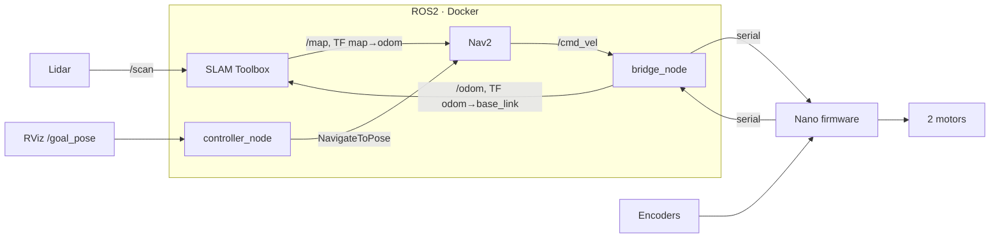
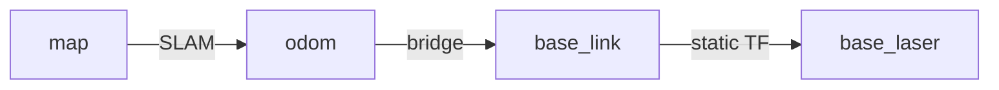

# Codebase Documentation

Three subsystems, all driven through the root **`Justfile`** (`just <target>`):

| Path | What |
|---|---|
| `motor_control_system/` | Arduino Nano firmware + a Python package for talking to it over serial |
| `ros2_ws/` | ROS2 Jazzy navigation stack (lidar → SLAM → Nav2 → motors), runs in Docker |
| `cad/` | OpenSCAD parametric wheel-encoder disk |
| `Justfile` | task runner — entry point for all three |
| `pyproject.toml`, `uv.lock`, `.venv`, `.python-version` | host-side Python, `uv` workspace, pinned to 3.12 (ROS2 Jazzy's version) |

> [!info] Status
> The firmware and serial protocol are solid and well tested. Wheel odometry is
> marginal (see [[#Known issues]]). Motor control is open-loop. The ROS2 pipeline
> runs end to end but is untuned.

## Architecture



The **bridge node** is the seam: ROS2 on one side, the custom binary serial
protocol on the other.

---

## motor_control_system/

PlatformIO project for the **Arduino Nano (ATmega328)**, plus host tooling in `py/`.

### Firmware

| Path | Role |
|---|---|
| `src/main.cpp` | The event loop. All motion logic lives here. |
| `src/config.hpp` | Every pin, geometry constant, PWM/ramp constant, timeout. |
| `src/macros.hpp` | ms↔s, deg↔rad helpers. |
| `lib/motor_driver/` | `MotorDriver` over the `L298N`/`L298NX2` library: `driveMove` (wheels same direction), `driveRotate` (opposite → spin in place), `stop`. No timing logic — `main.cpp` decides when to stop. |
| `lib/odometer_driver/` | `OdometerDriver`: pin-change ISRs count encoder edges; `poll(w1, w2, dt)` returns per-motor **shaft** angular velocity (rad/s) and resets the counters. Only channel A of each encoder is enabled (channel B is unreliable under load). |
| `lib/serial_protocol/` | `CommandPacket` / `ResponsePacket` (packed structs), CRC-16/MODBUS framing. |
| `platformio.ini` | Board + lib deps (`L298N`, `EnableInterrupt`, `FastCRC`). |

### Serial protocol

Fixed-size little-endian packets, `__attribute__((packed))`, trailing CRC-16/MODBUS
checksum. Defined once in `serial_protocol.hpp`; `py/protocol/protocol.py` is
generated from it (see [[#Codegen]]) so they can't drift.

**Command:** `seq_id, operation, arg: float, direction: int8` (−1 / 0 / +1). `arg`
depends on the op:

| Op | `arg` | Queued | Notes |
|---|---|---|---|
| `OP_QUEUE_MOVE` | duration (s) | yes | drive straight for a time |
| `OP_QUEUE_ROTATE` | duration (s) | yes | spin in place for a time |
| `OP_QUEUE_MOVE_DIST` | distance (m) | yes | drive straight, stop by odometry |
| `OP_QUEUE_ROTATE_ANGLE` | angle (rad) | yes | rotate chassis, stop by odometry |
| `OP_STOP` | — | no | halts the active command; no completion is sent for the aborted command |
| `OP_POLL_W` / `OP_POLL_DIST` | — | no | request a full data response |
| `OP_RESET_DIST` | — | no | zero the persistent odometry accumulators |
| `OP_DEBUG_SET_PWM` | raw PWM 0–255 | yes | no ramp; runs until `OP_STOP` or the 120 s backstop |
| `OP_DEBUG_RUN_N_ROTATIONS` | shaft revolutions | yes | raw shaft-angle target, no wheel geometry |

**Response:** `status`, `is_active`, `w1/w2` (shaft rad/s), `v1/v2` (wheel m/s),
`d1/d2` (cumulative distance magnitude), `x1/x2` (signed displacement). `status` ∈
`OK` (queued/accepted), `SUCCESS` (done), `REJECTED_FULL`, `TIMEOUT`.

**Execution model** (`main.cpp` `loop()`):

1. **Intake** — read one packet. Immediate ops run now; queued ops go into a 4-slot
   circular buffer (`QUEUE_SIZE`) and get an `OK` ack, or `REJECTED_FULL`.
2. **Control tick** — every `CONTROL_TICK_MS` (20 ms) while a command is active:
   poll odometry, accumulate progress, compute target PWM, drive, check completion.
3. **Deferred poll** — a poll that arrived mid-command is answered here, before the
   next command dispatches.
4. **Dispatch** — if idle and the queue is non-empty, pop the front and reset the
   progress trackers.

A queued command yields **two** responses: the `OK` at intake, then a
`SUCCESS`/`TIMEOUT` completion. Completion conditions:

- Distance/angle ops: both wheels reach the target (each tracked independently).
- `STALL_TIMEOUT_MS` (3 s): no odometry progress → abort.
- `MAX_COMMAND_MS` (120 s): hard emergency-stop backstop for any op.

### Control model

The firmware commands PWM but wants to control shaft angular velocity ω:

1. **Target ω** — a trapezoid, `ω_target = min(ω_accel, ω_decel, ω_max)`.
   Distance-tracked ops use `ω = √(2·α·d)` on both the traveled and remaining sides
   (`computeTargetOmegaByDistance`), which self-corrects when a wheel lags.
   Time-tracked ops use `ω = α·t` (`computeTargetOmegaByTime`), with no such anchor.
   Short moves collapse to a triangular profile automatically.
2. **ω → PWM** — linear fit `pwm = MIN_PWM + PWM_PER_RAD_S·ω`, clamped
   (`pwmFromOmega`).
3. **Wheel sync** — during `MOVE_DIST`, a proportional term (`SYNC_KP_PWM_PER_M`)
   trims the lagging/leading wheel.

This is **open-loop**: measured ω is reported but never feeds back into the PWM.

### config.hpp

| Constant | Meaning |
|---|---|
| `WHEEL_RADIUS_M`, `GEAR_RATIO` (64), `TRACK_WIDTH_M` (0.15) | wheel + chassis geometry |
| `ENCODER_PULSES_PER_REV_A/B` (24) | single-channel PPR (12 blades × 2 edges) |
| `MIN_PWM` (35), `MAX_PWM` (100) | actuator bounds (255 is the hardware ceiling) |
| `MAX_ANGULAR_VEL`, `MAX_ANGULAR_ACCEL`, `PWM_PER_RAD_S` | ramp shape and ω→PWM fit |
| `SYNC_KP_PWM_PER_M` (40) | wheel-sync gain |
| `CONTROL_TICK_MS` (20), `STALL_TIMEOUT_MS` (3000), `MAX_COMMAND_MS` (120000) | loop timing |
| `BAUD_RATE` (57600) | serial |

Several of these are still hand-seeded — see [[#Known issues]].
`py/scripts/calibrate.py` measures `GEAR_RATIO`, PPR, `MIN_PWM`, `PWM_PER_RAD_S`,
and `MAX_ANGULAR_VEL` against real hardware and prints values to paste in; it does
not write the file.

### Host tooling (py/)

Its own `pyproject.toml` — a `uv` workspace member (`motor-protocol`), installed
editable into the root `.venv` and into system Python inside the Docker container.

| Path | Role |
|---|---|
| `protocol/protocol.py` | **Generated.** `OP` / `Status` enums, `build_command_packet`, `parse_response_packet`. Only real dep: `fastcrc`. |
| `protocol/serial_client.py` | `SerialClient` — synchronous request/response over pyserial; owns the seq-id counter; waits out the Arduino's reset-on-open. |
| `scripts/send_command.py` | Manual CLI. Chains of `op:arg`, e.g. `"move_dist:1,poll_dist"`. |
| `scripts/calibrate.py` | Interactive calibration: `gear-ratio`, `ppr`, `min-pwm`, `velocity-curve`. |
| `scripts/tools.py` | `poll-w` — live ω readout while hand-turning a wheel. |
| `scripts/codegen/` | See [[#Codegen]]. |
| `tests/test_hardware.py` | Hardware-in-the-loop pytest — needs a board on a serial port. Covers every op, queue-full rejection, stall/timeout, stop-interrupts-move, direction reversal, distance-vs-poll agreement. |

### Commands

```bash
cd motor_control_system && pio run                                       # build
cd motor_control_system && pio run -t upload --upload-port /dev/cu.usbserial-XXXX
just mcs-test --port /dev/cu.usbserial-XXXX                              # hardware tests
just mcs-send-command "move:1,poll_w" --port /dev/cu.usbserial-XXXX
```

---

## ros2_ws/

**ROS2 Jazzy**, run in **Docker** — no native ROS2 install is expected.

### Docker

- `Dockerfile` — `ros:jazzy-ros-base-noble` + `slam-toolbox`, `nav2`,
  `foxglove-bridge`, `uv`. Installs `motor-protocol`, resolves `src/` deps with
  `rosdep`, runs `colcon build`. Also `sed`-patches an upstream `ldlidar_sl_ros2`
  bug (missing `#include <pthread.h>`) at build time rather than editing the submodule.
- `compose.yaml` — base service, no hardware needed. Exposes port 8765 (Foxglove).
- `compose.hardware.yaml` — overlay mapping `/dev/ttyUSB*` into the container. Layer
  it on only when the lidar + Nano are plugged in. On OrbStack, `orb usb attach`
  first; `just usb-devices` shows the paths Docker sees.
- `src/` is bind-mounted, so `just colcon-build` picks up edits without rebuilding
  the image.

### Packages (src/)

| Package | Contents |
|---|---|
| `robot_bringup` | `launch/robot.launch.py` (whole stack), `config/hardware.yaml` + `config/tuning.yaml`, `detect_ports.py` |
| `motor_control_bridge` | `bridge_node.py` (ROS2 ↔ serial), `serial_transport.py` (`MotorSerial` — background reader thread, packet framing) |
| `robot_controller` | `controller_node.py` — goal handling + safety backstop |
| `ldlidar_sl_ros2` | git **submodule**, the LD14P lidar driver, publishes `/scan` |

**`bridge_node.py`** — an `IDLE` / `IN_FLIGHT` state machine.

- Subscribes `/cmd_vel`. The firmware can only move *or* rotate, so each Twist
  becomes a discrete **intent** (angular before linear) issued as one **sliced**
  command: `slice_distance` (0.05 m) per `MOVE_DIST`, `slice_angle` (0.1 rad) per
  `ROTATE_ANGLE`. On completion it re-issues the current intent, so motion is a
  rapid stream of small queued commands.
- `STOP` intent interrupts immediately.
- Polls `OP_POLL_DIST` at 10 Hz when idle, and after every slice completion or
  `STOP` ACK (those responses carry no odometry).
- Integrates the change in the firmware's cumulative `x2` (wheel B only; encoder A
  is out) into a dead-reckoned pose: forward distance for a MOVE slice, chassis
  angle `2·Δx2 / track_width` for a ROTATE slice. Republishes `/odom` and the
  **odom→base_link** TF at 20 Hz. SLAM Toolbox supplies the **map→odom** correction.

**`controller_node.py`** — subscribes `/goal_pose` (RViz "2D Nav Goal"), drives
Nav2's `NavigateToPose` action, and hard-cancels if `/scan` shows something closer
than `emergency_stop_distance` (0.30 m). Normal avoidance is Nav2's job; this is a
last resort.

**`detect_ports.py`** — USB enumeration order isn't stable, so devices are
identified by behavior: the lidar streams bytes unprompted, the Nano stays silent
until polled. Returns `(nano_port, lidar_port)`.

### Frames



`base_link→base_laser` is a static publisher at z=0.18 m with **roll = π** — the
lidar is mounted upside-down.

### Config

- `hardware.yaml` — physical constants (`baud_rate`, `track_width`,
  `emergency_stop_distance`). **Generated** from `config.hpp`.
- `tuning.yaml` — algorithm params: bridge slice sizes/thresholds, all of SLAM
  Toolbox and Nav2. Safe to tweak without touching hardware. Lines marked
  `# mirrors hardware.yaml` must be **hand-synced** — SLAM/Nav2 launch files accept
  only one params file, so codegen can't reach them.

### Run

```bash
just docker-up            # or docker-up-hardware  (after `orb usb attach`)
just colcon-build         # after editing src/
just launch               # lidar + SLAM + Nav2 + bridge + controller
just foxglove-bridge      # connect Foxglove Studio to ws://localhost:8765
just docker-shell
just pkill                # kill all ros processes in the container
```

---

## cad/

`encoder_disk.scad` — a parametric 12-blade wheel-encoder disk (shaft bore, funnel,
cap), printed to replace a broken factory disk. Only the `INPUTS` section is meant
to be edited; `DERIVED` and `CHECKS` keep the model consistent and printable.
`d_shaft = 2.15` is tuned for print fit, not the nominal 2.00 mm shaft.
`encoder_disk.stl` is the current export.

---

## Codegen

`just generate` runs both generators (needs `compile_commands.json` — run `just
compiledb` first). Both do a real libclang parse of the firmware:

| Generator | Source | Output |
|---|---|---|
| `scripts/codegen/generate_protocol.py` | `lib/serial_protocol/serial_protocol.hpp` | `py/protocol/protocol.py` |
| `scripts/codegen/generate_hardware_config.py` | `src/config.hpp` (`BAUD_RATE`, `TRACK_WIDTH_M`) | `ros2_ws/src/robot_bringup/config/hardware.yaml` |

`scripts/codegen/firmware_parse.py` is the shared setup — it patches PlatformIO's
AVR compiler invocation so plain libclang can parse the headers.

After editing `serial_protocol.hpp` or `config.hpp`: run `just generate`, then
update any `# mirrors hardware.yaml` lines in `tuning.yaml` by hand.

---

## Known issues

1. **Close the control loop.** The biggest item. Both wheels travel different
   distances under the same PWM, so the open-loop ramp drifts on straight lines.
   Drive PWM from measured ω instead.
2. **Encoder hardware is fragile** — a printed replacement disk, channel B unusable,
   both motors running single-channel (~24 PPR).
3. **Wheel slip** off the line at short distances — the ramp is too steep at start.
4. **`TRACK_WIDTH_M` (0.15) is a placeholder** — affects rotation accuracy and the
   ROS2 `robot_radius` / odometry.
5. `MAX_ANGULAR_ACCEL` and `SYNC_KP_PWM_PER_M` are hand-tuned seeds with no
   calibration path.
6. Deceleration is jerky; effective PWM varies with load.
7. `MOVE_DIST` still diverges somewhat from ground truth.
