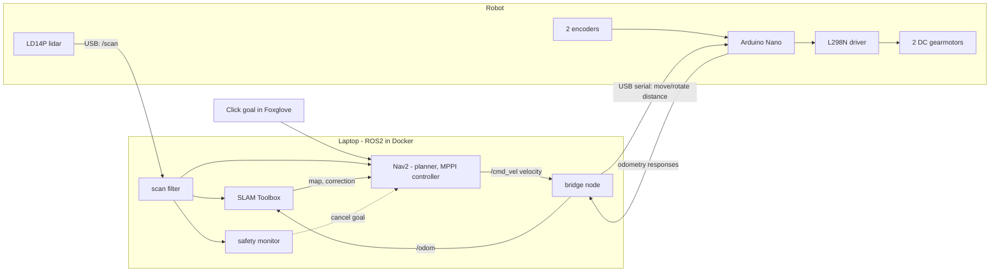
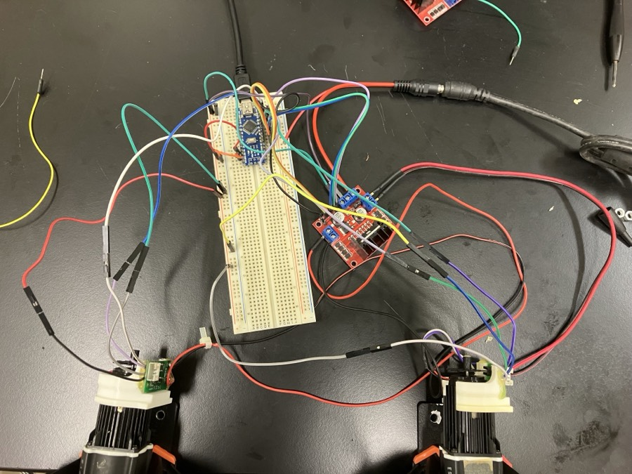
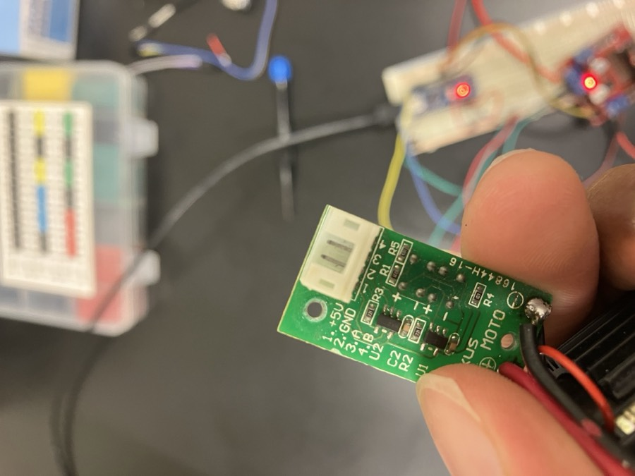
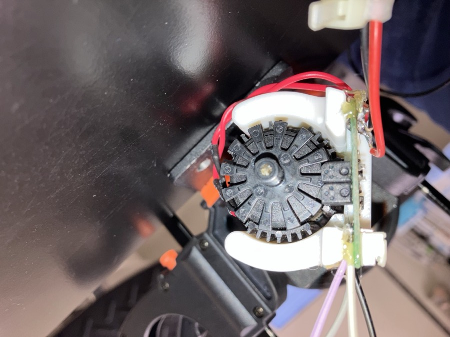

# Click-to-Go Robot Prototype: Report and Lessons Learned

This report records what was built, how it works, how the design changed along the way, and what the prototype taught. It is written so that someone planning the next robot can learn from this one without redoing its mistakes. Exact commands, pin tables, constants and procedures are in [technical-reference.md](technical-reference.md).

**Contents**

1. [Summary](#1-summary)
2. [Goal and outcome](#2-goal-and-outcome)
3. [System overview](#3-system-overview)
4. [Hardware as built](#4-hardware-as-built)
5. [Software design](#5-software-design)
6. [Coping with unreliable parts](#6-coping-with-unreliable-parts)
7. [How the design evolved](#7-how-the-design-evolved)
8. [Lessons learned](#8-lessons-learned)
9. [Why this frame stops here](#9-why-this-frame-stops-here)
10. [Appendix](#10-appendix)

---

## 1. Summary

**What exists.** A small two-wheel-drive robot that builds a map of a room with its lidar and drives to a point you click on that map. The motors are driven by an Arduino Nano through an L298N driver. A laptop runs the mapping and navigation software (ROS2 Jazzy, SLAM Toolbox, Nav2) and talks to the Nano over a custom binary serial protocol. The demo works end to end as of 22 October 2026.

**What is wrong with it.**

- One of the two wheel encoders does not work, so the robot has odometry from one wheel only and cannot correct drift or wheel mismatch itself.
- The lidar has blind regions: the robot's own frame blocks part of the view, and anything nearer than 0.27 m is discarded.
- It has three wheels (two driven, one swivel caster) on a frame that is unstable and cannot turn quickly.
- It is loud, and it is tethered to a wall for power and to a laptop by USB.

**What it taught, in six lines.**

1. Do not retrofit sensing onto motors. Encoder hardware that is undocumented and attached by hand cost weeks and was never made reliable. Use drives with feedback built in.
2. Odometry quality caps everything above it. The software stack (SLAM, Nav2) was the easy part once the lower layers were predictable.
3. Traction, weight distribution and chassis stiffness are control problems. Wheel slip and a tilted frame were mistaken for electrical faults for two days.
4. Use continuous velocity commands for ROS integration. Distance and angle commands were what the firmware needed for development and testing, but the planner emits velocities. Bridging the two works but makes the motion stop-and-go.
5. Test on the real hardware from the first firmware feature. The hardware-in-the-loop test suite was the most successful practice of the project.
6. Integrate modules early and test them together. The first full-robot test came late and surfaced most of the serious problems at once.

**What carries forward.** The serial protocol with code generation from a single header, the hardware-in-the-loop test suite, the Docker-based ROS2 environment, the port-detection and reconnect code, the lidar self-filter, and the Nav2/SLAM configuration are reusable on a better base. The mechanical design, the encoder retrofit and the distance-command firmware are not.

---

## 2. Goal and outcome

**Original goal.** A prototype mobile robot that could navigate indoors autonomously: build a map, avoid obstacles and go to a chosen point. The working target set in early August was "move autonomously to a point in the room and avoid obstacles", using ROS2 as the navigation base.

**Outcome.** The target was reached, with caveats. Clicking a goal on the live map makes the robot plan a path and drive to it. Accuracy was not measured quantitatively: Nav2's goal tolerance is set loose (0.25 m and 0.25 rad) and the known drift in the base is compensated by SLAM rather than removed.

**Change of scope.** On 23 October the prototype was closed as an initial prototype. The reasons were the constraints listed in [section 9](#9-why-this-frame-stops-here) and the availability of much better hardware. The remaining deliverable is this documentation.

---

## 3. System overview

Three layers, each with one job:

| Layer | Runs on | Job |
|---|---|---|
| Navigation | Laptop (ROS2) | Builds the map, localizes, plans, and emits a velocity command |
| Bridge | Laptop (ROS2) | Turns velocity commands into distance and angle commands, and turns encoder readings back into odometry |
| Motor control | Nano (firmware) | Executes distance and angle commands with a speed ramp, reads the encoder, enforces timeouts |

The laptop and the robot are joined by two USB cables (lidar, Nano), which is one of the reasons the prototype is tethered.

---

## 4. Hardware as built

### 4.1 Frame and drivetrain

- **Chassis.** A mesh/bar base with 3D-printed mounts for the two motors, a rear caster and the lidar.
- **Wheels.** Two driven wheels (radius 40 mm) on one axle at the front, and a 360-degree swivel caster at the back. A four-wheel layout (two driven wheels and two swivel casters) was tried first and abandoned: the casters' brakes caught when mounted close to the edge, and the frame was very unstable. The three-wheel triangle put the driving axle at the front so rotation pivots about the front, and the lidar sits on that same line.
- **Drive.** Two geared brushed DC motors with a 64:1 gearbox, driven open loop through an L298N. PWM is capped at 100 of 255 so the robot does not tip.
- **Known mechanical issues.** The mesh base flexes upward, which together with the rear caster's swept height tilted the robot backwards and unloaded the driven wheels. This was partly fixed with a taller caster mount (which then tilted the robot slightly forward) and added weight. The swivel caster still changes the robot's height as it turns.

### 4.2 Electronics and power

An Arduino Nano clone (ATmega328) drives an L298N dual H-bridge from a 12 V wall supply, and reads two encoders through pin-change interrupts. The Nano is powered over USB. Wiring was a breadboard with jumper wires, later routed through the frame.

*Bench wiring before the electronics were installed in the frame.*

The wiring was never made robust. Connections worked loose (the ground in particular), and there was no wire casing or strain relief. A power fault on 24 July (motors running at low speed at a correct PWM, voltage below expectations) cleared itself with no change to wiring or firmware; the suspected cause was the room's power supply, because a tripped breaker had been reported that morning, though not on the circuit in use. The cause was not confirmed.

### 4.3 Encoders

The motors have no built-in encoders. Each has a small add-on sensor board (silkscreened `MOTO`, pins `+5V, GND, A, B`) reading a slotted disk on the motor shaft. Part numbers could not be found for the boards or the disks.

*The add-on sensor board. Pins: 1 +5V, 2 GND, 3 A, 4 B.*

*A printed cradle holds the sensor board against the disk. Mounting height matters: if the sensor is too far from the disk, channels drop out.*

Facts that shaped the design:

- The sensor's channels A and B are two detectors side by side on the board, not a quadrature pair 90 degrees apart. This was found on 22 July when the direction-detection logic failed, after the code had initially assumed quadrature. Direction therefore cannot be read from the encoders; the firmware uses the direction of the command being executed.
- Only channel A of each encoder is used. With 12 slots and both edges counted, that gives 24 pulses per shaft revolution.
- Encoder A (motor A) was unreliable from the first week and is now unusable under drive. Encoder B works. The robot's odometry is therefore a single wheel.

**The encoder history, because it consumed a large share of the hardware effort:**

| Date | Event |
|---|---|
| 22 Jul | First encoder mounted and working. Quadrature assumption found to be wrong |
| 24 Jul | Second motor's encoder not triggering properly; disk part could not be identified |
| 4 Aug | Full-robot test: one encoder gives one channel only (sensor mounted too high); a disk on the other keeps losing blades |
| 5 Aug | Encoder A disabled in firmware |
| 6 Aug | Replacement disk printed (OpenSCAD model in `cad/`). Encoder A re-enabled, but reads about 2 where it should read about 200 |
| 7 Aug | Multimeter probing shows one channel permanently outputting noise; the other channel is used alone, at half the resolution |
| 17 Oct | Encoder A declared broken; firmware switched to encoder B only |

The root cause of the encoder A fault was never found. Candidates raised at the time were a mechanical fault, a wiring fault, interference from the motor, and a damaged board; none was confirmed.

### 4.4 Lidar

An LDRobot LD14P, connected over USB (230400 baud), mounted upside down at 0.18 m above the base. Its 0-degree direction points at the robot's back, which was found by driving forward and watching the 0-degree range grow; the software compensates with a rotation of 180 degrees about two axes in the static transform. The lidar can see the robot's own frame at about 0.19-0.23 m, so every return nearer than 0.27 m is discarded. This leaves a blind ring around the robot, and the frame also blocks part of the lidar's view, which creates dead zones.

---

## 5. Software design

### 5.1 Firmware

The firmware is one non-blocking loop: read a packet, run immediate commands, queue the rest, then drive the active command from a 20 ms control tick. It supports timed moves, distance and angle moves, a stop that clears the queue, and polling for odometry.

Key design points:

- **Commands, not velocities.** The firmware takes "move 0.20 m" or "rotate 0.30 rad" and stops itself when its encoder says it has arrived. This was a deliberate simplification: early advice was to put the logic on the microcontroller so the host stays simple.
- **Speed profile.** Each move follows a trapezoid in shaft angular velocity: accelerate, cruise, decelerate. The acceleration phase is limited so that the wheels do not spin in place at the start (the cause of the slip described in [section 7](#7-how-the-design-evolved)). Speed is converted to PWM with a calibrated linear map. This is **open loop**: the measured speed is reported but never fed back.
- **Blending.** The host sends short slices (0.20 m, 0.30 rad). Without blending, each slice would ramp up and down. If the next queued slice continues the same motion in the same direction, the firmware starts it without stopping, so a stream of slices behaves like one long move.
- **Protection.** A command with no progress for 3 s is aborted, and no command may run longer than 120 s. Packets carry a CRC-16, and every queued command is acknowledged twice (accepted, then completed).

### 5.2 Serial protocol

Fixed-size packets (9 bytes out, 37 bytes back) with a sequence number and CRC. The packet layout is defined once, in a C++ header, and a script that parses that header with libclang generates the Python side. The two sides cannot drift apart. This worked well and is worth keeping.

### 5.3 ROS2 pipeline

- **Scan filter.** Drops the robot's own body from the lidar scan.
- **SLAM Toolbox** in online mapping mode builds the map as the robot drives and corrects the odometry drift with scan matching.
- **Nav2** plans a path (Navfn planner) and follows it with an MPPI controller behind a rotation shim, which turns in place first when the heading error is large. Limits are 0.3 m/s and 1.5 rad/s.
- **Bridge node.** Receives `/cmd_vel`, splits it into alternating move and rotate slices, and integrates the encoder reports into the `/odom` estimate. A zero velocity stops the robot at once.
- **Safety monitor.** Cancels the goal if the filtered scan shows something closer than 0.30 m in the direction of travel.
- **Port detection and supervision.** Identifies the lidar and the Nano by the kernel driver bound to each USB serial device, restarts the lidar driver when it drops, and reconnects the Nano with a state reset.

Most of the ROS2 work was integration rather than algorithms: coordinate frames and their signs, parameter files, QoS settings, topic wiring, launch ordering, and making the pieces cope with USB drops.

---

## 6. Coping with unreliable parts

A stated aim of the project was to get a robot moving despite unreliable motors, odometry and lidar. The table summarizes what the system does about each and what is left over.

| Unreliable element | Symptom | What the system does | What remains |
|---|---|---|---|
| **Drive and wheels** | One wheel travels farther than the other at the same PWM; wheels spin in place at the start of short moves; robot veers on short moves | Acceleration-limited ramp; PWM floor and cap; added weight and a repositioned caster for traction; stall and time limits | Still open loop; straight lines drift; stopping is jerky; effective PWM changes with load |
| **Odometry** | Only one working encoder; no direction signal; wheel mismatch invisible | Distance and angle taken from the one good encoder; direction taken from the command; pose published as dead reckoning; SLAM scan matching corrects the drift (`map` to `odom`); Nav2 re-plans from the corrected pose | No wheel-to-wheel correction; heading errors are fixed by the map, not by the wheels; accuracy never measured |
| **Lidar** | Sees its own frame; blind ring and dead zones; 0-degree direction at the back; USB drops | Own-body returns removed; orientation verified by driving; supervisor restarts the driver on the new port; collision monitor and emergency cancel as backstops | The blind ring and dead zones remain; the exact angular extent of the dead zones was not recorded |
| **Serial link** | Nano resets when the port reopens; port numbers change; packets can be garbled | CRC on every packet; sequence numbers; reader resynchronizes after garbage; bridge clears its state on reconnect | Odometry that was in flight during a drop is lost |
| **Power and wiring** | Loose ground, low voltage, a day lost to an unexplained fault | Nothing in software | Needs a proper harness and a battery |

The central idea is that the **map corrects the wheels**: instead of trusting odometry, the robot re-localizes against the lidar scan every cycle. That is why a one-encoder, open-loop base is enough to demo. This is the design intent and the most plausible explanation; it was not tested by comparing runs with and without the correction.

---

## 7. How the design evolved

### 7.1 Timeline

| Dates (2026) | Work | Notes |
|---|---|---|
| 15-17 Jul | Serial protocol, motor driver, command queue and state machine, second motor; encoder code written untested | Early design: time-based commands only |
| 21-24 Jul | Encoders wired and debugged; gear ratio and distance calibrated; protocol code generation; CRC; hardware test suite | |
| 27-29 Jul | ROS2 in Docker; lidar bring-up and first map; in-place rotation | Docker with USB passthrough on macOS was slow and painful |
| 30 Jul-4 Aug | Chassis design, printing and assembly; first full-robot wiring and test | Four-wheel layout abandoned for three wheels |
| 5-7 Aug | Slip diagnosis; speed ramp redesigned; encoder disk redesigned and printed; encoder fault investigated | Last recorded work before a gap |
| 8 Aug-16 Oct | No development recorded in the repository | |
| 17-22 Oct | Switch to encoder B only; Nav2 and SLAM configuration; bridge rewritten around slices; lidar self-filter; firmware blending; first successful goal on 22 Oct | |
| 25 Oct | USB resilience: port detection, lidar supervisor, serial reconnect | |

Dates come from commits and voice-memo recordings, and are approximate where a memo says "yesterday".

### 7.2 Decisions that changed course

| Decision | Early plan | What happened | Why |
|---|---|---|---|
| Where the logic lives | Simple firmware, logic on the host | Firmware owns distance and angle control | Mentor advice: move logic to the microcontroller to simplify |
| How distance moves are executed | Convert distance to a time at intake and reuse the timed path (feasibility draft) | Firmware stops on encoder progress instead | Reason not recorded. The draft itself noted that speed depends on battery voltage and friction, which a fixed conversion would ignore |
| Speed ramp | A PWM curve over time and distance | Trapezoid in shaft angular velocity and acceleration | The PWM ramp was too steep and the wheels slipped |
| Slip mitigation | Check voltage, driver and wiring | Added weight, repositioned the caster, redesigned the ramp | Slip, not an electrical fault, was behind the veering |
| Wheel layout | Four wheels | Three wheels, driven axle at the front | Four wheels were unstable and the casters' brakes caught |
| Encoder repair | Source the original disk part | Printed a replacement; later abandoned encoder A | The part number did not exist online |
| Odometry source | Average of both encoders | Encoder B alone | Encoder A unusable under drive |
| Command execution | One command at a time | Blended chains of slices | Per-slice ramping made motion jerky |
| ROS2 environment | Native or VM install | Docker, then added USB-resilience code | Reproducibility, but USB passthrough through the macOS VM was fragile |
| Goal handling | A controller node that sent goals | Nav2 receives `/goal_pose` directly; the controller only monitors | Duplicate goals were being sent |

---

## 8. Lessons learned

Each lesson is stated as what happened and what to do instead. Hardware lessons come first because they cost the most.

### Hardware and mechanics

**1. Do not retrofit sensing onto motors.**
*What happened.* The encoders were add-on boards with no part numbers, attached by hand. Disks lost blades. Mounting height decided whether channels worked. Both channels turned out not to be a quadrature pair. About two weeks (22 July to 7 August) went into the encoders, and the fault on encoder A was never found.
*Next time.* Use drives with integrated, documented feedback (servo motors, or brushless or geared motors with factory encoders). The plan to use servo motors addresses this directly.

**2. Know exactly what each sensor can and cannot tell you before writing code.**
*What happened.* The firmware was initially written assuming a quadrature encoder, which would give direction. The code ran and produced noisy values, but the assumption was wrong, and it was found only on the bench. The firmware ended up inferring direction from the command, which is an open-loop assumption.
*Next time.* Check the datasheet, or put a scope or logic analyzer on the signals, before the design depends on them. This applies to any code written with an AI assistant too: hardware assumptions in it are hypotheses until verified.

**3. Traction and weight distribution are part of the control system.**
*What happened.* One motor appeared to spin faster than the other on the same PWM. The first hypothesis was wrong voltage, then the driver, then the caster, and only then wheel slip. The robot was also tilted backwards, so the driven wheels carried too little weight, because the mesh base arched and the swivel caster's swept height was larger than the driven wheels'.
*Next time.* Make the chassis rigid, put the centre of gravity over the driven wheels, and test traction with a loaded frame early. Isolate faults by changing one thing at a time (lift a wheel, swap motors, test unloaded) before suspecting electronics. If an arm will be added later, plan for its mass and reach from the start.

**4. Build a proper wiring harness and plan power.**
*What happened.* Breadboard and jumper wiring failed repeatedly at the ground connection, the power fault of 24 July cost most of a day, and a Nano board was short-circuited early on (spares were on hand).
*Next time.* Use terminal blocks or a printed board, strain relief and wire casing; keep a multimeter at the bench and spare controller boards; add a physical emergency stop or power cutoff, since this prototype had only software stops. When readings stop making sense, suspect the instrument or the supply before the design.

**5. Mount the lidar where the frame cannot obstruct it.**
*What happened.* The lidar sits in the middle of the robot, so the frame blocks its view and creates dead zones. Initially this dead zone kept Nav2 from planning, because the frame's returns appeared in the map and the costmaps until they were filtered out. Its 0-degree direction was at the robot's back and it was mounted upside down, so the first frame transform was wrong.
*Next time.* Mount the lidar above or outside the frame with a clear 360-degree view, confirm its orientation with a drive-forward test, and record the size of the dead zones, which this prototype did not.

### Software, testing and architecture

**6. Use continuous velocity commands for ROS integration.**
*What happened.* Distance and angle commands ("move this far", "turn this far") were what the firmware needed in the early stages: they let each operation be developed, calibrated and tested on its own. Nav2, however, produces a velocity every 100 ms, and the firmware cannot move and turn at once. The bridge therefore converts each velocity into 0.20 m and 0.30 rad slices, alternating when both are wanted, and the firmware has to blend them to avoid ramping at each slice boundary. A curved path still stops at every switch between moving and turning.
*Next time.* Keep discrete commands for bring-up, calibration and tests, but have the base controller also take continuous velocity commands, as a servo drive or an off-the-shelf diff-drive controller does natively. The slicing layer then disappears.

**7. Write hardware-in-the-loop tests from the first firmware feature.**
*What happened.* A pytest suite that talks to the real board over serial was built up with the firmware (14 test functions, covering every operation, stalls, stop behaviour and blending). Each change was checked on the real board as it was made, and the distance test cross-checks against the polled distance. On 5 August, when one wheel appeared to travel farther than the other, the passing tests helped rule out the firmware and driver and pointed to wheel slip.
*Next time.* Keep this pattern; it was the most valuable practice of the project. The gap is the ROS2 side, which has no automated tests.

**8. Generate shared definitions from one source, and keep documentation honest.**
*What happened.* The packet format is defined once in a C++ header and the Python side is generated from it. In three months it never drifted. Constants shared with ROS2 are partly generated and partly hand-mirrored in `tuning.yaml`, and the hand-mirrored ones are the ones that can drift. Documentation drifted too: an LLM-generated overview that was updated alongside the code still lists a constant that exists only on a side branch.
*Next time.* Generate every duplicated value, or remove the duplication. Treat generated documentation as a draft to be checked against the code.

**9. Prefer running ROS2 natively on the robot.**
*What happened.* ROS2 ran in a Docker container on a Mac. Getting USB devices into the container was a recurring cost: devices did not appear, reappeared under new names, and the lidar driver died on every drop. This produced a port-detection module, a lidar supervisor and reconnect logic.
*Next time.* Use a small onboard Linux computer running ROS2 natively. This removes the USB passthrough, the laptop tether and the supporting code.

### Process

**10. Integrate modules early and test them together.**
*What happened.* Modules were built and tested separately before the first full-robot assembly. When the robot was assembled, the tilt, slip, wiring and caster problems appeared at once, leaving little time to fix them. Software that had passed bench tests behaved differently under a real load.
*Next time.* Integrate modules as soon as each exists, even on a crude chassis, and test every new change on the assembled system.

### What went well

- The serial protocol, codegen and, above all, the hardware-in-the-loop test suite gave a firmware base that was easy to change safely.
- The speed-ramp rework fixed the slip well enough to demonstrate.
- Port detection and reconnect code made the stack tolerant of USB drops.
- Mapping and navigation worked on a poor base, which supports using the map to correct odometry.

---

## 9. Why this frame stops here

| Constraint | Cause | Consequence for the next prototype |
|---|---|---|
| One encoder is broken | Retrofitted encoder hardware; fault on motor A never diagnosed | Servo motors with integrated feedback |
| Lidar dead zones | Frame in view; 0.27 m blind ring; lidar mounted in the middle of the robot | Mount the lidar clear of the body with a full 360-degree view |
| Three wheels, unstable frame, slow turning | Frame is a mesh base with a swivel caster; the four-wheel layout failed | Rigid four-wheel chassis, low centre of gravity |
| Loud | Not diagnosed (brushed geared motors driven by PWM are a likely contributor) | Quieter motors and drive |
| Tethered to a wall | 12 V wall supply; USB to a laptop | Battery plus an onboard computer |

Together these mean this specific frame will not become a useful lab robot, which matches the decision to end this stage. The prototype remains valuable because the software and the lessons carry over. The off-the-shelf mini-robot with wheels and lidar skips most of the hardware problems recorded here.

---

## 10. Appendix

### A. What can be reused

| Item | Where | Reusable on a new base? |
|---|---|---|
| Packet protocol with generated Python side | `lib/serial_protocol/`, `py/scripts/codegen/` | Yes, if a custom microcontroller remains |
| Hardware test suite | `py/tests/` | Pattern yes, tests need adapting |
| Docker environment | `ros2_ws/Dockerfile`, `compose.yaml` | Yes |
| Port detection and lidar supervisor | `robot_bringup/` | Yes |
| Lidar self-filter | `robot_controller/scan_filter_node.py` | Yes, with new parameters |
| Safety monitor | `robot_controller/controller_node.py` | Yes |
| Nav2 and SLAM configuration | `robot_bringup/config/tuning.yaml` | Starting point; retune for the new base |
| Bridge node | `motor_control_bridge/` | No (replace with a velocity-based interface) |
| Distance-command firmware and ramp | `src/main.cpp` | Not for ROS integration (a velocity interface replaces it); the discrete commands remain useful for bring-up and tests |
| Encoder disk model | `cad/` | Only if the same encoders return |
| Calibration scripts | `py/scripts/calibrate.py` | Method yes |

### B. Bill of materials

| Item | Detail |
|---|---|
| Microcontroller | Arduino Nano clone (ATmega328, CH340) |
| Motor driver | L298N dual H-bridge |
| Motors | Two geared DC motors, 64:1; model not recorded |
| Encoders | Add-on `MOTO` sensor board and slotted disk per motor; part numbers not found |
| Wheels | Two driven wheels (40 mm radius), one swivel caster |
| Lidar | LDRobot LD14P |
| Frame | Mesh/bar base, 3D-printed mounts, M4 screws |
| Power | 12 V wall supply |
| Computer | Laptop running macOS and Docker (OrbStack) |
