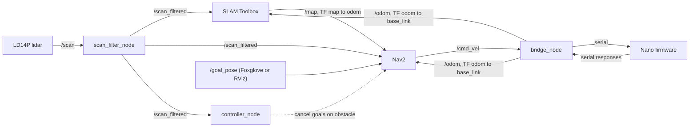

# Technical Reference

As-built reference for the click-to-go prototype, as of `master` (October 2026). It describes what the code does now, and was checked against the source rather than copied from earlier generated documentation. For the story behind these choices, see [prototype-report-abridged.md](prototype-report-abridged.md).

**Contents**

1. [Repository map](#1-repository-map)
2. [Quick start](#2-quick-start-fresh-clone-to-demo)
3. [Tooling map](#3-tooling-map)
4. [Hardware reference](#4-hardware-reference)
5. [Firmware](#5-firmware)
6. [Serial protocol](#6-serial-protocol)
7. [ROS2 workspace](#7-ros2-workspace)
8. [Calibration](#8-calibration)
9. [Testing](#9-testing)
10. [Encoder disk CAD](#10-encoder-disk-cad)
11. [Gotchas and troubleshooting](#11-gotchas-and-troubleshooting)
12. [Known issues and open items](#12-known-issues-and-open-items)

---

## 1. Repository map

| Path | What it is |
|---|---|
| `motor_control_system/` | PlatformIO firmware for the Arduino Nano, plus the Python host package for talking to it |
| `motor_control_system/src/` | `main.cpp` (event loop and control), `config.hpp` (pins, geometry, PWM constants), `macros.hpp` |
| `motor_control_system/lib/` | `motor_driver` (L298N wrapper), `odometer_driver` (encoder ISRs), `serial_protocol` (packet structs and CRC) |
| `motor_control_system/py/` | `uv` workspace member `motor-protocol`: `protocol/` (generated packet code, `SerialClient`), `scripts/` (CLI tools, calibration, codegen), `tests/` (hardware tests) |
| `ros2_ws/` | ROS2 Jazzy workspace, run in Docker |
| `ros2_ws/src/motor_control_bridge/` | `/cmd_vel` to serial commands; publishes `/odom` and the odom to base_link TF |
| `ros2_ws/src/robot_bringup/` | Launch file, YAML config, port detection, lidar supervisor |
| `ros2_ws/src/robot_controller/` | Safety monitor for Nav2 goals; lidar self-body filter |
| `ros2_ws/src/ldlidar_sl_ros2/` | Git submodule: vendor LD14P lidar driver |
| `cad/` | OpenSCAD source and STL for the replacement encoder disk |
| `Justfile` | Task runner; entry point for almost everything |
| `pyproject.toml`, `uv.lock`, `.python-version` | Host Python environment (`uv` workspace, pinned to Python 3.12 to match ROS2 Jazzy on Ubuntu 24.04) |

Branches worth knowing: `per-wheel-sync` holds an unfinished closed-loop wheel-sync controller that needs both encoders to work (see [section 5.5](#55-the-per-wheel-sync-branch)).

---

## 2. Quick start: fresh clone to demo

Everything below assumes macOS with OrbStack (what the prototype was developed on). The container needs the lidar and the Nano on USB, and OrbStack forwards USB into its VM with `orb usb attach`.

### 2.1 Prerequisites

| Tool | Used for |
|---|---|
| [`just`](https://github.com/casey/just) | Task runner (run `just` with no arguments to list recipes) |
| [`uv`](https://docs.astral.sh/uv/) | Host Python environment |
| [PlatformIO](https://platformio.org/) (`pio`) | Building and flashing the firmware |
| Docker via OrbStack | ROS2 container (`orb` CLI is needed for USB forwarding) |
| `ruff`, `ty`, `clang-format`, `clang-tidy`, `fd` | Only for `just format` and `just lint` |
| [Foxglove Studio](https://foxglove.dev/) | Visualising the map and sending goals (RViz2 in the container also works) |

### 2.2 Clone and set up Python

```bash
git clone --recurse-submodules <repo-url>   # the lidar driver is a submodule
cd robot
uv sync                                     # creates .venv, installs motor-protocol editable
```

If you cloned without `--recurse-submodules`: `git submodule update --init`.

### 2.3 Build and flash the firmware

```bash
cd motor_control_system
pio run                                              # build
pio run -t upload --upload-port /dev/cu.usbserial-XXXX
```

The Nano is a clone with a CH340 USB-serial chip. Upload speed is 57600 (set in `platformio.ini`). The serial port name changes between machines; list candidates with `ls /dev/cu.usbserial-*`.

Quick sanity check (run from the repo root; the board must be attached to the host, not to the container):

```bash
just mcs-send-command "move_dist:0.3,poll_dist" --port /dev/cu.usbserial-XXXX
just mcs-test --port /dev/cu.usbserial-XXXX          # full hardware test suite
```

### 2.4 Run the navigation stack

```bash
just docker-up          # build (first time) and start the ros2 container
just usb-attach         # forward the lidar and Nano from the host into the OrbStack VM
just usb-devices        # sanity check: expect one cp210x (lidar) and one ch341-uart (Nano)
just colcon-build       # needed after the first start and after editing ros2_ws/src
just launch             # lidar + SLAM Toolbox + Nav2 + bridge + controller
just foxglove-bridge    # in a second terminal; then connect Foxglove to ws://localhost:8765
```

In Foxglove, publish a pose on `/goal_pose` with its pose-publishing tool (in RViz this is "2D Nav Goal"). One click is one goal. Nav2 plans on the live SLAM map and the robot drives there.

Stop everything with Ctrl-C on `just launch`. If a launch is left running (for example the `just` process was killed), `just pkill` cleans it up. `just launch` refuses to start a second copy.

**The Nano can only be opened by one program at a time.** To use the host-side scripts or tests, stop the ROS launch first (`just pkill`) and detach USB from the VM (`just usb-detach`) so the device appears on the host as `/dev/cu.usbserial-XXXX`. Re-run `just usb-attach` before launching ROS again.

---

## 3. Tooling map

### 3.1 Justfile recipes

Run `just` to list them. All recipes run from the repo root.

| Recipe | What it does |
|---|---|
| `format` | `ruff check --select I --fix`, `ruff format`, and `clang-format` over the firmware sources |
| `lint` | `ruff check`, `ty check` (ROS2 packages excluded; their imports only exist in the container), and `clang-tidy` on `main.cpp` |
| `compiledb` | Generates `motor_control_system/compile_commands.json` if missing. Required by the codegen scripts and clang-tidy |
| `update` | Deletes and regenerates `compile_commands.json` |
| `generate-protocol` | Regenerates `py/protocol/protocol.py` from `serial_protocol.hpp` |
| `generate-config` | Runs `generate-protocol`, then regenerates `ros2_ws/src/robot_bringup/config/hardware.yaml` from `config.hpp` |
| `generate` | Both of the above |
| `mcs-send-command <chain> --port ...` | Manual serial CLI, e.g. `"move:1,poll_w"` |
| `mcs-test --port ...` | Hardware integration tests (pytest) |
| `docker-up` | `docker compose up -d` for `ros2_ws/compose.yaml` |
| `docker-rebuild` | Same with `--build`; use after changing the Dockerfile or apt dependencies |
| `docker-shell` | `docker exec -it ros2 bash` |
| `colcon-build` | Cleans our three Python packages' build and install folders, then runs `colcon build` in the container. The clean step avoids a stale install after the container is recreated |
| `launch` | Starts the full stack (see [section 7.5](#75-launch-and-config)); refuses to run twice; forwards Ctrl-C into the container |
| `foxglove-bridge` | Starts `foxglove_bridge` on port 8765 |
| `pkill` | SIGINT every `ros2 launch`, wait up to 5 s, then SIGKILL stragglers |
| `usb-attach` / `usb-detach` | Attach or detach all USB devices listed by `orb usb list` |
| `usb-devices` | Shows the `ttyUSB*` devices the VM actually sees and their kernel drivers (`cp210x` is the lidar, `ch341-uart` is the Nano). Empty output means nothing reached the VM and a physical replug is needed |

### 3.2 Python environment

- The root `pyproject.toml` is a `uv` workspace. `motor_control_system/py` is a member (`motor-protocol`), installed editable into the root `.venv`.
- Inside the container, `motor-protocol` is installed into system Python with `uv pip install --system --break-system-packages` (see the Dockerfile), because ROS2 nodes run under the system interpreter.
- `requires-python = ~=3.12.0` is deliberate: ROS2 Jazzy on Ubuntu 24.04 ships Python 3.12.
- `motor-protocol` has one real dependency, `fastcrc`. The root project also pulls in `pyserial` and `libclang` (codegen).

### 3.3 Docker

- `ros2_ws/Dockerfile` builds on `ros:jazzy-ros-base-noble`, adds SLAM Toolbox, Nav2, `foxglove-bridge` and `ros-dev-tools`, installs `motor-protocol`, resolves package dependencies with `rosdep`, then runs `colcon build`.
- It `sed`-patches an upstream bug in the lidar driver (`log_module.h` has `#include <pthread.h>` commented out) at build time instead of editing the submodule.
- `ros2_ws/compose.yaml` defines one service, `ros2`:
  - `./src` is bind-mounted, so source edits need only `just colcon-build`, not an image rebuild.
  - `./logs` is mounted at `/root/.ros/log`, so ROS logs survive container recreation (look in `ros2_ws/logs/`).
  - `device_cgroup_rules: c 188:* rmw` lets the container open any `ttyUSB*` (major number 188), including a device that comes back under a new number after a USB drop. No `devices:` mapping is used; the container creates the `/dev` node itself (see `usb_ports.py`).
  - Port 8765 is published for Foxglove.
- There is no hardware-specific compose override in the current tree.

### 3.4 Codegen

Both generators do a real libclang parse of the firmware headers. `firmware_parse.py` patches PlatformIO's AVR compiler invocation so plain libclang can parse them. Run `just compiledb` first (the generate recipes do it for you).

| Generator | Source | Output |
|---|---|---|
| `scripts/codegen/generate_protocol.py` | `lib/serial_protocol/serial_protocol.hpp` | `py/protocol/protocol.py` (enums, packet builder and parser, CLI name table) |
| `scripts/codegen/generate_hardware_config.py` | `src/config.hpp` (`BAUD_RATE`, `TRACK_WIDTH_M`) | `ros2_ws/src/robot_bringup/config/hardware.yaml` |

After editing `serial_protocol.hpp` or `config.hpp`, run `just generate`. Generated files carry a "do not edit by hand" header. Some `tuning.yaml` values are marked `# mirrors hardware.yaml`; these must be updated by hand because SLAM Toolbox and Nav2 launch files accept only one params file.

---

## 4. Hardware reference

Everything computing and planning runs off-board: a laptop running the ROS2 container is connected by USB to both the Nano and the lidar. The 12 V motor supply is a wall-powered supply.

### 4.1 Components

| Part | Detail |
|---|---|
| Microcontroller | Arduino Nano clone (ATmega328, CH340 USB-serial) |
| Motor driver | L298N dual H-bridge board; control through the `L298N` library (`L298NX2`) |
| Motors | Two geared DC motors, 64:1 gear ratio (`GEAR_RATIO`), each with an add-on optical encoder board. Model and part numbers were not recorded |
| Encoder | Board silkscreened `MOTO`, pins `1 +5V, 2 GND, 3 A, 4 B`, reading a slotted disk on the motor shaft. See [photos in the report](prototype-report-abridged.md#43-encoders) |
| Wheels | Two driven wheels (radius 0.04 m) on one axle at the front, plus a rear 360-degree swivel caster |
| Lidar | LDRobot LD14P (D200 family), CP2102 USB-serial, 230400 baud, publishes `/scan` |
| Frame | Mesh/bar base with 3D-printed motor mounts and a rear caster mount, printed on the lab's single desktop 3D printer (an A1 Mini) |
| Power | 12 V wall supply to the L298N; the Nano is powered over its USB connection |

### 4.2 Pin assignments (`src/config.hpp`)

| Signal | Nano pin |
|---|---|
| Motor A IN1 / IN2 / EN (PWM) | 6 / 5 / 10 |
| Motor B IN1 / IN2 / EN (PWM) | 3 / 4 / 9 |
| Encoder A channels A / B | 7 / 8 |
| Encoder B channels A / B | 11 / 12 |

Do not use the L298N's ENA/ENB jumpers; PWM is driven from pins 10 and 9. Encoder inputs use `INPUT_PULLUP` and pin-change interrupts through the `EnableInterrupt` library.

Which physical side is motor A versus B was not recorded in the repository. The sign convention that was verified on the robot is: `ROTATE` direction `+1` turns the robot counter-clockwise, matching the sign of `angular.z`.

### 4.3 Geometry and constants

| Constant | Value | Notes |
|---|---|---|
| `WHEEL_RADIUS_M` | 0.04 | |
| `GEAR_RATIO` | 64 | Measured by hand-turning a wheel (see [section 8](#8-calibration)) |
| `TRACK_WIDTH_M` | 0.334 | Marked TODO; not verified with a 360-degree rotation test |
| `ENCODER_PULSES_PER_REV_A/B` | 24 | 12 slots x 2 edges, **one channel only** |
| `robot_radius` (Nav2) | 0.174 m | Centre of rotation to farthest edge, measured |
| Lidar height | 0.18 m | `base_link` to `base_laser` |
| Max linear / angular speed (Nav2) | 0.3 m/s / 1.5 rad/s | |

`MAX_ANGULAR_VEL` (545 rad/s at the motor shaft) is about 0.34 m/s at the wheel (`545.4 / 64 x 0.04`). One encoder pulse is about 0.16 mm of wheel travel (`2 pi x 0.04 m / (24 x 64)`), so encoder resolution is not the limiting factor.

### 4.4 Encoder behaviour that matters

- Each encoder board has two optical sensors side by side. They are **not 90 degrees out of phase**, so there is no quadrature signal and direction cannot be read from the encoders. The firmware takes direction from the command being executed.
- Only channel A is enabled on each motor. With both edges counted, that is 24 pulses per shaft revolution.
- **Encoder A (motor A) is unusable under motor drive** and is not used for control. The firmware computes all distance and angle from encoder B alone. In an in-place rotation both wheels cover the same arc, so one wheel gives the chassis angle (`2 x arc / track_width`).
- Consequence: wheel-to-wheel differences are invisible to the firmware, so straight-line drift cannot be corrected by it.

---

## 5. Firmware

`motor_control_system/src/main.cpp` is one non-blocking `loop()`. There are no blocking delays and no RTOS.

### 5.1 Loop stages

Each pass of `loop()` runs these in order:

1. **Intake.** Read one packet if a full one is available and the CRC matches (`readCommand`). Immediate operations run now: `STOP`, `POLL_W`/`POLL_DIST`, `RESET_DIST`. Everything else goes into a circular queue of `QUEUE_SIZE = 4` and gets an `OK` acknowledgement, or `REJECTED_FULL` if the queue plus the active command is already at capacity.
2. **Control tick.** If a command is active and `CONTROL_TICK_MS` (20 ms) has elapsed: poll the encoders, update progress, compute the target PWM, drive the motors, check for completion.
3. **Deferred poll.** A poll that arrived mid-command is answered here.
4. **Dispatch.** If idle and the queue has entries, pop the front, reset progress trackers, and make it active. Driving starts on the next tick.

A queued command therefore produces **two** responses: `OK` at intake and `SUCCESS` or `TIMEOUT` when it finishes. `STOP` drops the active command and the whole queue, and sends only its own acknowledgement.

### 5.2 Operation kinds

| Operation | Progress measure | Finished when |
|---|---|---|
| `QUEUE_MOVE` / `QUEUE_ROTATE` | Elapsed time | `arg` seconds have passed |
| `QUEUE_MOVE_DIST` | Distance from encoder B | Distance reaches the chain's target |
| `QUEUE_ROTATE_ANGLE` | Angle from encoder B | Angle reaches the chain's target |
| `DEBUG_RUN_N_ROTATIONS` | Raw shaft angle (encoder B) | N shaft revolutions; independent of wheel geometry |
| `DEBUG_SET_PWM` | None | `STOP`, or the 120 s backstop |

Safety limits: `STALL_TIMEOUT_MS` (3 s) aborts a distance/angle command that makes no progress; `MAX_COMMAND_MS` (120 s) is an absolute backstop.

### 5.3 Speed profile (open loop)

The firmware commands PWM but plans in shaft angular velocity, `omega`:

1. **Target omega is a trapezoid:** `min(omega_up, omega_down, MAX_ANGULAR_VEL)`.
   - Distance- and angle-tracked commands use `omega = sqrt(2 x accel x d)`, with `d` the distance already travelled for the ramp up and the distance remaining for the ramp down. This self-corrects if a wheel lags.
   - Time-tracked commands use `omega = accel x t`.
   - Short moves collapse to a triangle automatically.
2. **Omega to PWM:** linear map `pwm = MIN_PWM + PWM_PER_RAD_S x omega`, clamped to `[MIN_PWM, MAX_PWM]`.
3. **Slew limit:** the commanded omega never rises faster than `MAX_ANGULAR_ACCEL` per tick.

Measured omega is reported to the host but never feeds back into PWM. That is the main reason the robot drifts on long straight lines.

### 5.4 Blending

A *chain* is consecutive `MOVE_DIST` (or `ROTATE_ANGLE`) commands with the same operation and direction. Progress and targets are cumulative over the chain, and the ramp-down plans for the active command plus any queued commands that continue it. When a command completes and the next queued one continues the chain, the firmware starts it without stopping. A stream of short slices therefore runs at one speed profile instead of ramping up and down for every slice. A different operation or direction ends the chain with a normal stop. A hardware test (`test_blended_slices_match_one_long_move`) checks that two 0.3 m slices take about as long as one 0.6 m move.

### 5.5 The `per-wheel-sync` branch

The branch adds a proportional correction (`SYNC_KP_PWM_PER_M`) between the two wheels' travelled distance. It requires both encoders to work, so it was not merged. It is a reasonable starting point if the encoder problem is ever fixed.

### 5.6 Constants (`src/config.hpp`)

| Constant | Value | Meaning |
|---|---|---|
| `QUEUE_SIZE` | 4 | Pending-command slots |
| `BAUD_RATE` | 57600 | Serial rate (host and firmware must match) |
| `CONTROL_TICK_MS` | 20 | Control loop period |
| `STALL_TIMEOUT_MS` | 3000 | No-progress abort |
| `MAX_COMMAND_MS` | 120000 | Absolute backstop |
| `MIN_PWM` | 35 | Lowest PWM that moves the robot under base load; marked TODO |
| `MAX_PWM` | 100 | Cap (hardware ceiling is 255); lowered to reduce tipping risk |
| `MAX_ANGULAR_VEL` | 545.415 rad/s | Motor shaft; from `calibrate.py velocity-curve` |
| `MAX_ANGULAR_ACCEL` | 200 rad/s^2 | Motor shaft; hand-tuned seed with no calibration path |
| `PWM_PER_RAD_S` | 0.07944 | Slope from `calibrate.py velocity-curve`. The comment in `config.hpp` gives `(MAX_PWM - MIN_PWM) / MAX_ANGULAR_VEL`, but that formula would give about 0.119; at the configured value, `MAX_ANGULAR_VEL` maps to a PWM of about 78, below `MAX_PWM`. The mismatch suggests the value was fitted at a different `MAX_PWM` and not refreshed |

Effective PWM depends on load: a value tuned on a light robot is too low once weight is added.

---

## 6. Serial protocol

Fixed-size little-endian packets, `__attribute__((packed))`, 57600 baud, ending with a CRC-16/MODBUS over the preceding bytes. The packet structs are defined once in `lib/serial_protocol/serial_protocol.hpp`; `py/protocol/protocol.py` is generated from it.

### 6.1 Command packet (9 bytes)

| Field | Type | Notes |
|---|---|---|
| `seq_id` | `uint8` | Chosen by the host; echoed in every response to that command (wraps at 256) |
| `operation` | `uint8` | See below |
| `arg` | `float32` | Meaning depends on the operation |
| `direction` | `int8` | `-1`, `0`, `+1` |
| `checksum` | `uint16` | CRC-16/MODBUS |

### 6.2 Operations

| # | Name | `arg` | Queued | Notes |
|---|---|---|---|---|
| 1 | `QUEUE_MOVE` | duration (s) | yes | Straight; `dir` `-1` back, `+1` forward |
| 2 | `QUEUE_ROTATE` | duration (s) | yes | In place; `+1` is counter-clockwise |
| 3 | `STOP` | none | no | Halts the active command and drops all queued ones |
| 4 | `POLL_W` | none | no | Requests a full data response |
| 5 | `QUEUE_MOVE_DIST` | distance (m) | yes | Stops by encoder B |
| 6 | `QUEUE_ROTATE_ANGLE` | angle (rad) | yes | Stops by encoder B |
| 7 | `DEBUG_RUN_N_ROTATIONS` | shaft revolutions | yes | Raw shaft angle target |
| 8 | `DEBUG_SET_PWM` | raw PWM 0-255 (clamped to `MAX_PWM`) | yes | No ramp; runs until `STOP` or backstop |
| 9 | `RESET_DIST` | none | no | Zeroes the cumulative odometry |
| 10 | `POLL_DIST` | none | no | Same response as `POLL_W` |

### 6.3 Response packet (37 bytes)

`seq_id (u8)`, `status (u8)`, `is_active (u8)`, then eight `float32` values, then `checksum (u16)`.

| Field | Meaning |
|---|---|
| `status` | `0 OK` (queued/accepted), `1 SUCCESS` (done), `2 REJECTED_FULL`, `3 TIMEOUT` |
| `w1`, `w2` | Motor A / B shaft angular velocity (rad/s) |
| `v1`, `v2` | Wheel linear velocity (m/s) |
| `d1`, `d2` | Cumulative distance magnitude (m) |
| `x1`, `x2` | Cumulative **signed** displacement (m); signed by the active command's direction |

Only poll responses carry real data; acknowledgements and completions send zeros. When `is_active` is 0, the velocity fields are unsigned magnitudes because direction is unknown.

### 6.4 Host side

`SerialClient` (`py/protocol/serial_client.py`) is a synchronous request/response client for scripts and tests. It waits out the Arduino's reset on port open. The ROS bridge uses its own `MotorSerial` (`serial_transport.py`) with a background reader thread and automatic reconnect, but the same generated packet builder and parser.

---

## 7. ROS2 workspace

ROS2 Jazzy, in Docker. Source is bind-mounted at `/workspace/ros2_ws/src`.

### 7.1 Data flow



### 7.2 Frames

`map` (from SLAM) to `odom` to `base_link` (from the bridge) to `base_laser` (static). The static transform sits at z = 0.18 m with **roll = pi** (the lidar is mounted upside down) and **yaw = pi** (its 0 degree direction points at the robot's back; found by driving forward and watching the 0-degree range grow). The lidar's 180-degree direction is therefore the robot's front (`scan_front_angle_deg`). `laser_scan_dir: true` in `lidar.yaml` compensates for the reversed handedness of an upside-down scan.

SLAM Toolbox runs in **online async mapping mode**: the robot builds the map as it drives, with no prebuilt map.

### 7.3 Nodes

**`bridge_node` (`motor_control_bridge`).** The seam between ROS2 and the serial protocol.

- Subscribes to `/cmd_vel` (a `Twist`) and publishes `/odom` and the `odom` to `base_link` TF at 20 Hz.
- The firmware can only move or rotate, not both at once, so a Twist is turned into alternating **slices**: `slice_distance` (0.20 m) per `QUEUE_MOVE_DIST` and `slice_angle` (0.30 rad) per `QUEUE_ROTATE_ANGLE`. The bridge accumulates the distance and angle the Twist has asked for, and each time it is free it sends whichever is further behind. Components below `linear_threshold` (0.02 m/s) or `angular_threshold` (0.05 rad/s) are dropped as noise.
- Up to two slices are kept in flight (`_MAX_PIPELINE`). The second goes out early when it continues the same chain so the firmware can blend. A different motion waits for the chain to drain, so a combined move-and-turn command stops at every switch.
- A zero Twist sends `STOP` immediately. If no `/cmd_vel` arrives for `cmd_vel_timeout` (0.5 s) the bridge stops dispatching and sends `STOP`.
- Slice completions and `STOP` acknowledgements carry no odometry, so the bridge sends a `POLL_DIST` after each. It also polls at 10 Hz when idle, because Nav2 and SLAM need a continuous `/odom` stream.
- Dead reckoning: it integrates the change in wheel B's signed displacement `x2`. For a move slice that is forward distance; for a rotate slice it is chassis angle `2 x dx2 / track_width`. Heading uses the midpoint so an arc doesn't skew the pose.
- If the USB link drops, `MotorSerial` reopens the port (finding the Nano again by driver) and bumps a `generation` counter. The Arduino resets on every reconnect, so the bridge clears its queued slices and re-baselines odometry. The pose is held in the meantime.

**`controller_node` (`robot_controller`).** A safety monitor, not a goal sender. Goals reach Nav2 directly from `/goal_pose`. This node logs goal state changes and distance remaining, and cancels all `NavigateToPose` goals if `/scan_filtered` shows something closer than `emergency_stop_distance` (0.30 m). It only checks while the robot is commanded to move, in a +/-40 degree cone in the direction of travel, so a robot parked next to a wall can still be sent away from it and rotation never trips it. Normal avoidance is Nav2's job.

**`scan_filter_node` (`robot_controller`).** Republishes `/scan` as `/scan_filtered` with every return closer than `scan_min_range` (0.27 m) set to NaN. Those returns are the robot's own frame (about 0.19-0.23 m from the lidar). Without the filter they appear in the SLAM map and costmaps, the robot starts inside an inscribed obstacle zone, and Nav2 cannot plan. SLAM Toolbox has no minimum-range setting, so the filter is applied once at the source and everything downstream reads `/scan_filtered`.

**`detect_ports.py` and `usb_ports.py`.** USB enumeration order is not stable, so each port is identified by the kernel driver bound to it, read from sysfs (`cp210x` = lidar, `ch341-uart` = Nano). This never touches the ports. If sysfs is ambiguous it falls back to probing: the lidar streams bytes unprompted, the Nano stays silent. It also creates a missing `/dev` node from sysfs, which a reconnected device needs inside the container.

**`lidar_supervisor.py`.** Runs the lidar driver (parameters from `config/lidar.yaml`) and restarts it on a freshly found port whenever it exits. The driver quits when the lidar's USB connection drops (`publish time out`), and the device returns under a new `ttyUSB` number, so a plain launch respawn would reopen a dead path. If OrbStack's USB forwarding itself is stuck (the VM's `/sys/bus/usb/devices` shows only root hubs), a physical replug is still required; the supervisor keeps retrying.

### 7.4 Nav2 and SLAM configuration (`tuning.yaml`)

| Component | Choice |
|---|---|
| Planner | `NavfnPlanner`, followed by a simple smoother |
| Controller | Rotation shim (`angular_dist_threshold` 0.785 rad) wrapping MPPI with a differential-drive model; 2000 samples, 56 steps, `model_dt` 0.1 s (must equal 1/`controller_frequency`) |
| Speed limits | `vx_max` 0.3 m/s, `vx_min` -0.1 m/s, `wz_max` 1.5 rad/s |
| Goal tolerance | 0.25 m and 0.25 rad |
| Costmaps | `robot_radius` 0.174 m, inflation radius 0.4 m, 0.05 m resolution |
| Velocity smoother | Open-loop feedback on `/odom` |
| Collision monitor | `FootprintApproach` polygon, 1.2 s time-before-collision, reads `/scan_filtered` |
| SLAM Toolbox | Online async, 0.05 m resolution, loop closing on, `max_laser_range` 12 m |

### 7.5 Launch and config

`robot.launch.py` starts: `lidar_supervisor`, the static lidar TF, `scan_filter_node`, SLAM Toolbox (`online_async_launch.py`), Nav2 (`navigation_launch.py`), `bridge_node`, and `controller_node`.

| File | Purpose |
|---|---|
| `config/hardware.yaml` | Physical constants: `baud_rate`, `track_width`, `emergency_stop_distance`, `scan_min_range`, `scan_front_angle_deg`, `emergency_cone_deg`. **Generated** from `config.hpp` where possible; edit the generator for values not in `config.hpp` |
| `config/tuning.yaml` | Algorithm parameters: bridge slice sizes and thresholds, all of SLAM Toolbox and Nav2. Safe to adjust without touching hardware |
| `config/lidar.yaml` | LD14P driver parameters (baud 230400, frame `base_laser`) |

Values in `tuning.yaml` marked `# mirrors hardware.yaml` (for example `robot_radius`, `vx_max`, `wz_max`, `max_laser_range`) must be kept in sync by hand.

Logs: ROS logs for every node, plus a directory per launch, are written to `ros2_ws/logs/` on the host. The bridge logs stops, queue-full rejections, stalled slices and lost polls. Do not capture output with `timeout just launch`; use Ctrl-C and `just pkill`.

---

## 8. Calibration

`motor_control_system/py/scripts/calibrate.py` measures constants against real hardware and **prints** values to paste into `config.hpp`; it never writes the file. Run from `motor_control_system/py/`:

| Subcommand | Measures | Procedure |
|---|---|---|
| `gear-ratio` | `GEAR_RATIO` | Motor unpowered. Hand-turn the wheel a known number of revolutions; the script counts shaft revolutions from the encoder |
| `ppr` | `ENCODER_PULSES_PER_REV_A/B` | Hand-turn the wheel a known number of revolutions and compare to measured distance |
| `min-pwm` | `MIN_PWM` | With the robot on the ground, steps PWM upward from a dead stop and asks you whether the wheel started turning. Stiction varies, so repeat the sweep |
| `velocity-curve` | `MAX_ANGULAR_VEL`, `PWM_PER_RAD_S` | Holds each PWM step to reach steady state, records shaft speed, fits a line through the `MIN_PWM` anchor, and reports 90% of the top speed as `MAX_ANGULAR_VEL` |

The `ppr`, `gear-ratio`, `min-pwm` and `velocity-curve` subcommands all read motor B's encoder (`w2`).

Hand-turning with a known revolution count was used because slow-motion video (240 fps) was not fast enough to count shaft revolutions at the 64:1 gear ratio.

Not calibrated: `MAX_ANGULAR_ACCEL` (tune by feel, watching for wheel slip or stall) and `TRACK_WIDTH_M` (verify with a measured 360-degree in-place rotation).

`scripts/tools.py poll-w` prints live shaft speeds while you turn a wheel by hand, which is useful for checking whether an encoder is alive.

---

## 9. Testing

`motor_control_system/py/tests/test_hardware.py` is a hardware-in-the-loop suite (14 test functions, parametrized). It needs a board on a serial port:

```bash
just mcs-test --port /dev/cu.usbserial-XXXX
```

It covers every operation, queue-full rejection, stall timeout, `STOP` interrupting a move, `STOP` clearing the queue, direction reversal netting out, agreement between `MOVE_DIST` and the polled distance, poll-while-moving, and blended slices matching one long move.

`conftest.py` resets the board before each test, including draining any stray response. A stalled command can still deliver a late completion up to `STALL_TIMEOUT_S` after a `STOP`, so the reset waits `STALL_TIMEOUT_S + 2` seconds before declaring the buffer clean. Keep that in mind when a test seems to hang at start-up.

There are no automated tests for the ROS2 packages.

---

## 10. Encoder disk CAD

`cad/encoder_disk.scad` is a parametric 12-blade encoder disk in OpenSCAD (shaft bore, funnel, cap), printed to replace a broken disk. Defaults reproduce the original disk measured off the robot (12 blades, 24.30 mm across the tips, nominal 2.00 mm shaft). Edit only the `INPUTS` section; `DERIVED` and `CHECKS` keep the model consistent and printable. `d_shaft = 2.15` is tuned for print fit, not the nominal 2.00 mm. `encoder_disk.stl` is the current export.

---

## 11. Gotchas and troubleshooting

| Symptom | Cause and fix |
|---|---|
| First command after opening the port is ignored | The Nano resets when the port opens (DTR). Both clients wait about 2 s for the firmware to boot |
| Port is busy or the board does not answer from the host | Something else holds it, usually the ROS container. `just pkill`, then `just usb-detach` |
| No lidar scans, or `usb-devices` prints nothing | OrbStack USB forwarding did not reach the VM. `just usb-attach`; if still empty, physically replug the device |
| Lidar scan stops mid-run | The driver exits when the USB link drops; `lidar_supervisor` restarts it on the new port. If it keeps failing, replug |
| Bridge logs "firmware serial link lost/restored" | USB dropped. The Arduino reset, so the bridge cleared its queue and re-baselined odometry |
| Edits in `ros2_ws/src` have no effect | Run `just colcon-build`. The image's old install can shadow an incremental build, which is why the recipe cleans our packages first |
| `just launch` says a launch is already running | A previous launch survived. `just pkill` |
| Nav2 will not plan; robot starts "in an obstacle" | Own-body returns are in the costmap. Check that `scan_filter_node` is running and that everything reads `/scan_filtered` |
| Robot turns the wrong way or drives into walls it should avoid | Check lidar orientation: roll/yaw of the static TF, `laser_scan_dir`, and `scan_front_angle_deg`. Verify by driving forward and watching which range grows |
| Robot veers on straight lines | Expected. Open-loop drive with one working encoder; see [section 12](#12-known-issues-and-open-items) |
| Wheels spin in place at the start of short moves | Slip. Raise the load on the driven wheels, lower `MAX_ANGULAR_ACCEL`, and check that `MIN_PWM` suits the current weight |
| `ty` or `ruff` complains about ROS imports | ROS2 packages are excluded from `ty`; their imports only exist in the container |
| Generated files differ after `just generate` | Expected after changing `config.hpp` or `serial_protocol.hpp`. Commit the regenerated files and update any `# mirrors hardware.yaml` lines by hand |

---

## 12. Known issues and open items

1. **Close the control loop.** The firmware is open loop. Both wheels travel different distances under the same PWM, so straight lines drift. Fixing it needs working encoders on both motors (see `per-wheel-sync`) or, better, drives with built-in velocity feedback.
2. **Encoder hardware is fragile.** Encoder A is unusable under drive; encoder B works on one channel only (about 24 pulses per revolution). The add-on encoder boards and disks are undocumented parts, and the replacement printed disk did not cure the fault on motor A. The root cause of the encoder A fault was never found.
3. **Direction is inferred, not measured.** Encoder channels are not in quadrature.
4. **Wheel slip at the start of short moves.** Mitigated by the ramp, added weight and rear-caster placement; not eliminated.
5. **`TRACK_WIDTH_M` (0.334) is unverified.** It sets rotation accuracy and odometry heading.
6. **`MAX_ANGULAR_ACCEL` and `MIN_PWM` are hand-tuned seeds** with no calibration path, and effective PWM varies with load.
7. **Deceleration is jerky,** and `MOVE_DIST` still diverges somewhat from ground truth. No quantitative accuracy measurements were recorded.
8. **Mixed move-and-turn commands stop at every switch** because the firmware can only do one at a time; this makes motion visibly stop-and-go during curved paths.
9. **No automated tests for the ROS2 packages,** and no physical emergency stop. Software safety is the 0.30 m cancel in `controller_node`, the collision monitor, `MAX_PWM = 100`, the 3 s stall watchdog and the 120 s backstop.
10. **Two sets of constants are hand-synced** (`tuning.yaml` values marked `# mirrors hardware.yaml`).